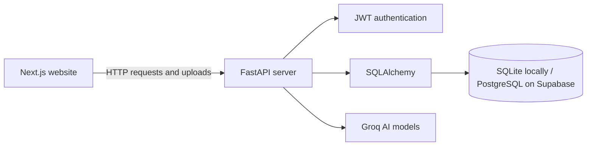

# SnapStudy

SnapStudy helps students understand educational images, chat with an AI tutor, and create study notes.

## How the system works



### Website

The website is built with Next.js and React. It provides account registration and login, image analysis, study chat, session history, notes, profile, and AI preferences. It sends requests to the backend at `http://localhost:5000/api`. For protected requests, it sends the login token in the `Authorization` header.

### Backend

The backend is a FastAPI application in `backend/app.py`. Uvicorn runs the server on port 5000 locally. SQLAlchemy connects to the local SQLite database or to PostgreSQL when `DATABASE_URL` is set. Flask and Flask-SQLAlchemy are not used.

The existing database and AI handlers are synchronous, so FastAPI runs them in worker threads. SQLAlchemy provides a database session to each request and removes it when the handler finishes. Existing database records are kept.

### What happens when a student uses the app

1. The student signs up or logs in. The backend saves a password hash and returns a signed login token that expires after seven days.
2. The website saves the token in browser storage and sends it with requests that need authentication.
3. The student uploads an image. The backend sends it to Groq for analysis, saves the image and result as a study session, and returns the result to the website.
4. The student can ask questions about a session, create or edit notes, and upload PDF, TXT, or Markdown files.
5. SQLAlchemy saves accounts, sessions, chat messages, notes, and AI preferences in SQLite.

## Project folders and files

| Path | What it contains |
| --- | --- |
| `frontend/src/app/` | Website pages and routes |
| `frontend/src/components/` | Reusable website components |
| `frontend/src/context/` | Shared React state |
| `backend/app.py` | FastAPI routes, database models, login, and AI features |
| `backend/requirements.txt` | Python packages for the backend |
| `backend/snapstudy.db` | Local SQLite database |
| `backend/Procfile` | Command used to run the API when deployed |
| `start-dev.bat` | Windows script for starting both parts of the app |

## Run the app on your computer

### Set up the backend

Create a file named `backend/.env`:

```dotenv
SECRET_KEY=put-a-long-random-secret-here
GROQ_API_KEY=put-your-groq-key-here
```

The Groq key is needed for AI features. The secret key protects login tokens. Keep both values private and do not commit real keys to Git.

Open PowerShell and run:

```powershell
cd backend
python -m venv venv
.\venv\Scripts\Activate.ps1
pip install -r requirements.txt
uvicorn app:app --reload --host 0.0.0.0 --port 5000
```

You can also run `python app.py` from the `backend` folder.

### Set up the website

Open a second PowerShell window and run:

```powershell
cd frontend
npm ci
npm run dev
```

Open `http://localhost:3000` in your browser. The frontend defaults to the API at `http://localhost:5000`; set `NEXT_PUBLIC_API_URL` to change it. You can also start both servers with `start-dev.bat` on Windows.

When the backend is running, its interactive API page is at `http://localhost:5000/docs`.

## Deploy with Vercel and Render

The repository includes a `render.yaml` Blueprint for the FastAPI service. Vercel should use `frontend/` as the project root and will detect Next.js automatically. Supabase provides the hosted PostgreSQL database.

1. Push the project to the GitHub repository connected to your Vercel and Render accounts.
2. Create a Supabase project and open its **Connect** dialog. Choose the **Session pooler** connection string and keep it private. Supabase's Free plan includes PostgreSQL at no cost with 500 MB of database storage, but it can pause projects after a week of low activity and does not include automatic backups. The deployed database starts empty; the local SQLite database is not copied automatically.
3. In Render, deploy the Blueprint from the repository root. When prompted, set `DATABASE_URL` to the Supabase session-pooler connection string and `GROQ_API_KEY` to your Groq key. Render generates `SECRET_KEY` from the Blueprint. Keep the database password and AI key private.
4. In Vercel, import the same repository and set the project root to `frontend/`. Add `NEXT_PUBLIC_API_URL` with the Render API's origin, for example `https://snapstudy-api.onrender.com` (do not add `/api`). Deploy the project.
5. After Vercel assigns the website URL, update the Render service's `CORS_ORIGINS` value to that exact origin, such as `https://your-project.vercel.app`, then redeploy the backend.
6. Check the Render health endpoint at `https://your-api.onrender.com/openapi.json` and open the Vercel website. Register a new account and test a protected page and image analysis.

The Render web service in the Blueprint uses the free compute plan, which may sleep when idle. This can make the first request slower. Supabase Free can pause after a week of low database activity. The API needs outbound access to Groq and a valid `GROQ_API_KEY` for AI features.

## API routes

All API routes start with `/api`. Signup and login are public. Other routes need a valid login token in the `Authorization: Bearer <token>` header.

| Feature | Main routes | What they do |
| --- | --- | --- |
| Accounts | `POST /api/auth/signup`, `POST /api/auth/login` | Create an account or log in |
| Image analysis | `POST /api/analyze` | Analyze an uploaded image and save a study session |
| Study chat | `POST /api/chat` | Ask questions about a study session |
| Sessions | `GET /api/sessions`, `GET /api/sessions/{id}` | List sessions or view one session |
| Session notes | `GET /api/notes/{session_id}`, `PUT /api/notes/{session_id}`, `POST /api/notes/generate` | View, save, or create notes for a session |
| Workspace notes | `/api/workspace-notes` and `/api/workspace-notes/{id}` | Create, find, update, delete, upload, and discuss notes |
| AI preferences | `GET /api/ai-settings`, `PUT /api/ai-settings` | View or change AI response preferences |

Image and document uploads use multipart form data. The route handlers in `backend/app.py` show the exact fields each request accepts.

## Interview revision guide

**How is the app built?** The website uses Next.js and React. It sends requests to a FastAPI backend. The backend checks login tokens, saves data through SQLAlchemy, stores data in SQLite locally or PostgreSQL when deployed, and calls Groq for AI features.

**How does login work?** The backend saves a hash of each password. After signup or login, it sends the website a signed token that expires in seven days. The website sends that token with protected requests. The backend checks the token and only returns data for that user.

**How does image analysis work?** The website uploads an image. The backend sends the image and a learning prompt to a Groq vision model. It saves the image and analysis in a study session and sends the result back to the website.

**How does the app save information?** SQLAlchemy maps Python models to database tables. It uses a request-scoped session to read or write data. SQLite is the local database.

**Why use FastAPI?** FastAPI handles API routes and provides an interactive API page. The current database and AI code is synchronous, so the app runs that work in worker threads.

**What are the current limits?** SQLite is simple to run locally but is not ideal for many simultaneous writes. AI features need a working Groq key and available models. The website currently uses a fixed local API address, which should be configurable before deployment.

**What could be improved?** Add automated tests, clearer request validation, database migrations, structured logs, and a configurable API address. If more users need to write data at the same time, consider PostgreSQL.
